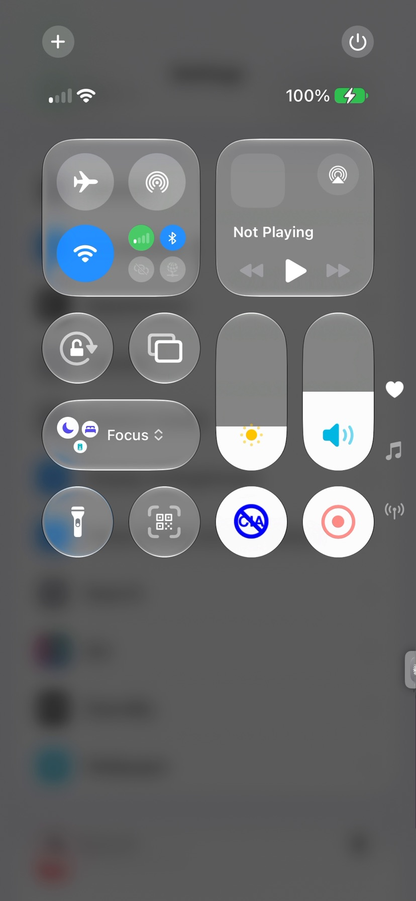
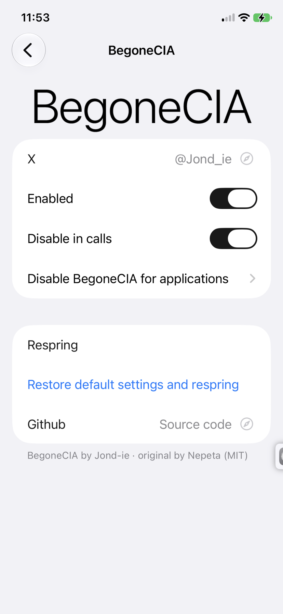
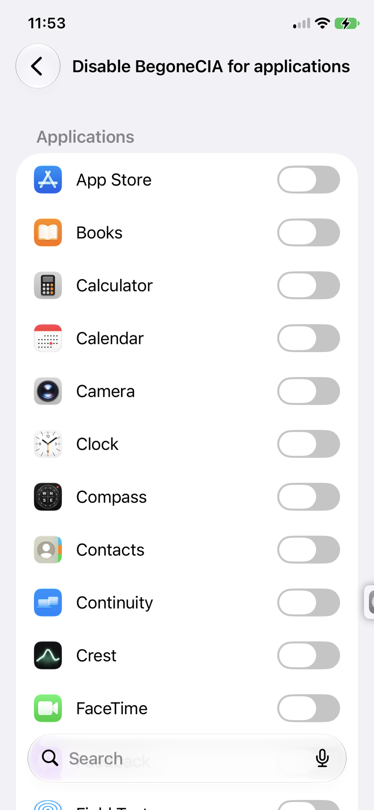

<p align="center"></p>

<h1 align="center">BegoneCIA</h1>

<p align="center">
  <b>One Control Center button that cuts off the camera, mic and location for every app.</b><br>
  iOS 15–27 · Rootless and RootHide · a port of Nepeta's original
</p>

<p align="center">
  <a href="https://jond-ie.github.io/repo/begonecia/"></a>
  <a href="https://jond-ie.github.io/repo/"></a>
  <a href="https://jond-ie.github.io/repo/depictions/com.johndie.begonecia.html"></a>
  <a href="LICENSE"></a>
</p>

<p align="center">
  
  
  
</p>

## How it works

1. **Tap the button** in Control Center. While it's on, every app gets silence from the mic, no camera picture and no location. Apps don't get an error, they just get nothing.
2. **Calls still work.** Disable in calls is on by default: during a call BegoneCIA steps aside so people can hear you, then comes back when you hang up.
3. **Pick your exceptions.** In the apps you tick under Disable BegoneCIA for applications, it switches off while they're open.

Triggr users can turn it on, off or toggle it from any button or gesture.

## Install

1. Add **https://jond-ie.github.io/repo/** to Sileo or Zebra.
2. Install **BegoneCIA**. CCSupport, PreferenceLoader, AltList and Cephei come with it (Cephei is on the Chariz repo).
3. Add the button in **Settings → Control Center**. On iOS 27, open its settings from the TweakSettings app.

RootHide users can also take the `_roothide_` file from [Releases](../../releases).

## Light by design

- **Nothing on a timer.** SpringBoard decides once, when you switch apps or tap the button, and every app follows that one setting. Nothing polls in the background.
- **No crashes, no nags.** Apps get silence, no picture and no location instead of a permission error, so they keep working.
- **Private.** BegoneCIA never touches the network and keeps no logs.

A jailbroken phone is less secure overall. BegoneCIA protects your camera, mic and location, but it doesn't change that.

## Tested on

| iPhone | iOS |
|---|---|
| 11 Pro | 27.2.1 |
| SE (2nd gen) | 15.2, 17.5.1, 27.0.1 |
| 11 Pro Max | 16.2 (with a real phone call) |
| 11 Pro | 18.6.2 |
| 8 Plus | 16.7 |
| 7 | 15.8.6 |

The RootHide build hasn't been on a device yet. If an app still gets through, [open an issue](../../issues) with the app and your iOS version.

<details>
<summary><strong>How the port works</strong> (for developers)</summary>

### What changed for Rootless

**Build and packaging**
- `ARCHS = arm64 arm64e`, built with `THEOS_PACKAGE_SCHEME=rootless` (or RootHide). armv7/armv7s dropped.
- Hooks run through ElleKit. Depends on `com.opa334.ccsupport`, `ws.hbang.common` (Cephei), PreferenceLoader and AltList.
- Package id `com.johndie.begonecia`, with `Conflicts`/`Replaces: me.nepeta.begonecia`.

**Fixes found on devices**
- **State didn't reach sandboxed apps.** Cephei 2 keeps preferences under `/var/jb`, which apps and `mediaserverd` can't read. The on/off state is mirrored into a Darwin notify state (`notify_set_state`) that every process can read; SpringBoard re-seeds it at launch and decides the per-app state when the front app changes.
- **Maps bypassed the location block.** MapKit passes its delegate to the `CLLocationManager` designated initializer instead of `-setDelegate:`, so that initializer is hooked too (with a separate variant for iOS 15).
- **The mic produced noise, not silence.** The AGC buffer is zeroed after processing, and audio read from the RemoteIO / VoiceProcessingIO input bus is zeroed in apps (covers AVAudioEngine).
- **Siri still heard the mic.** Siri records in `corespeechd` through an AudioQueue; AudioQueue input callbacks are wrapped and handed silence. On iOS 18, `-[CSAudioRecorder voiceControllerAudioCallback:forStream:buffer:]` buffers are zeroed instead.
- **iOS 17 moved audio processing** into `audiomxd`, which is in the filter.
- **iOS 27 kills WebKit helpers that get patched audio functions,** so BegoneCIA stays out of `com.apple.WebKit.*` processes (they never need it).
- **Disable in calls** follows `TUCallCenter` (active, held and dialing calls) and SpringBoard's call events.

**Known caveat: the mic AGC subtype.** The `mediaserverd` silencer keys on the voice-processing AGC units (`'agcc'` / `'agc2'`). If camera and location are blocked but the mic still records on your device, build with `BC_DEBUG=1` and look for the `AudioUnitProcess` subtypes in the log.

### Building

Requires [Theos](https://theos.dev) with the Rootless scheme (or RootHide).

```bash
make package FINALPACKAGE=1 THEOS_PACKAGE_SCHEME=rootless
```

Your toolchain must emit the versioned arm64e ABI (Xcode's clang does): every arm64e slice should have cpusubtype `0x80000002`, or A12 and newer phones go into safe mode. For arm64e builds that also load on iOS 15.0 and 15.1, compile without signed `class_ro` pointers. If your toolchain can't do either, build `ARCHS=arm64` only.

Debug logging (view on the device with `oslog`):

```bash
make package install THEOS_PACKAGE_SCHEME=rootless BC_DEBUG=1
```

`PORT-NOTES.md` has the working notes from the port.

</details>

## License and credits

MIT, same as the original; see [LICENSE](LICENSE). Nepeta's copyright is kept and the licence ships inside the package.

- **BegoneCIA** by **Eva (Nepeta)** ([original source](https://github.com/NepetaDev/BegoneCIA)): the idea, the Control Center module and the core technique.
- **Rootless and RootHide port** by **Jond_ie** ([Jond_ie repo](https://jond-ie.github.io/repo/), [@Jond_ie](https://x.com/Jond_ie)).
- Built with [Theos](https://theos.dev/).
